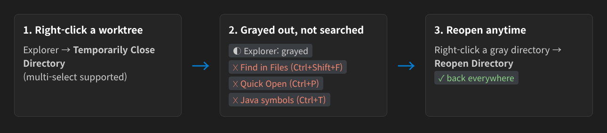
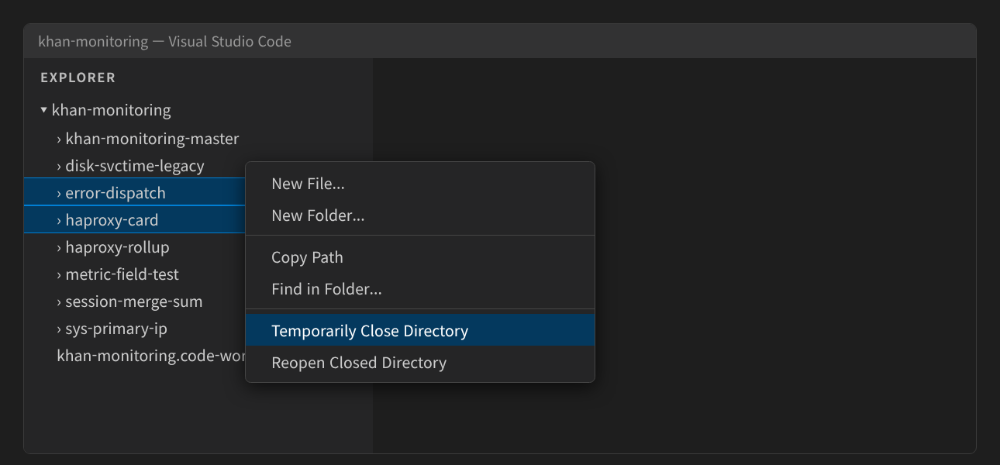
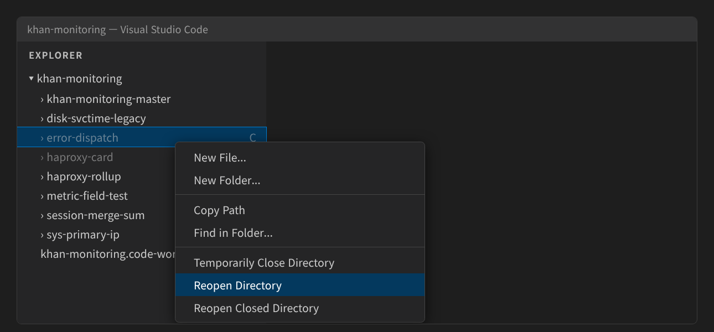
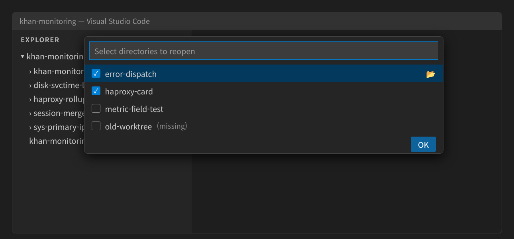

# Folder Stash

**Close and reopen sub directories like Eclipse's Close Project — closed ones disappear from search too.**

> [한국어](README_ko.md)

When you keep several git worktrees (or modules) under one opened folder, every search hits all of them:
Find in Files, Quick Open and Go to Symbol return the same class from every worktree.
Search filters work, but typing them every time is tedious.

Folder Stash lets you **close** the directories you are not working on, and **reopen** them in one click.



## Close a directory

Right-click one or more directories in the Explorer → **Temporarily Close Directory**.



Closed directories **stay in the Explorer, grayed out** with a `C` badge, and are excluded from Find in Files and Quick Open.
To hide them from the Explorer as well, set `folderStash.closeStyle` to `hide`.

## Reopen

Right-click a grayed directory → **Reopen Directory** (multi-select supported).



To pick from a list (or in `hide` style), right-click anywhere in the Explorer or run from the Command Palette
→ **Reopen Closed Directory**. Check the directories to reopen and press Enter.



- 📂 button (Reopen now): reopen just that directory immediately
- `(missing)`: the directory was deleted from disk (clean up with 📂)

## Where closed directories disappear

| Feature | Gray (`dim`, default) | Hide (`hide`) |
|---|---|---|
| Explorer | grayed out | hidden |
| Find in Files (Ctrl+Shift+F), Quick Open (Ctrl+P) | excluded (`search.exclude`) | excluded (`files.exclude`) |
| Go to Symbol in Workspace (Ctrl+T), Go to Definition (Java) | excluded (`java.import.exclusions`) | same |

- A grayed directory can still be expanded; VS Code has no API to block expanding a folder.
- Quick Open's **recently opened** list may still show files you opened before closing.
- The gray color may also appear where the same file is shown elsewhere, such as editor tabs.
- On remote hosts (Remote-SSH etc.) the gray directory's context menu may not appear;
  use **Reopen Closed Directory** instead.

- Settings are saved in `.vscode/settings.json`. Only entries added by this extension are added or removed;
  your own entries are kept.
- When the Java exclusion list changes, a **Reload** notification appears.
  - On close: `Java: Clean Java Language Server Workspace` (needed to drop already imported projects)
  - On reopen: `Java: Import Java projects in workspace`
- If you turn off **Use Exclude Settings and Ignore Files** (gear icon) in Find in Files,
  closed directories are searched again.

## Settings

| Setting | Default | Description |
|---|---|---|
| `folderStash.closeStyle` | `dim` | `dim`: keep grayed in the Explorer / `hide`: hide from the Explorer too. Changing it moves already closed directories |
| `folderStash.excludeFromJava` | `true` | Also exclude closed directories from Java project import |

## Behavior

- The closed list is stored per folder in VS Code's workspace storage.
- If you delete an entry from `search.exclude`/`files.exclude` in `.vscode/settings.json` yourself, it is treated as reopened
  and removed from the list and from the Java exclusions.
- Paths you already put in `search.exclude` or `files.exclude` yourself are skipped, so reopening never removes your own entries.
- Reopening removes this path's `true` entry from both `search.exclude` and `files.exclude`.
- Changing `closeStyle` or upgrading from an earlier version moves closed entries to the other setting,
  which modifies `.vscode/settings.json`.
- Changes to the user-level `java.import.exclusions` are not applied to this folder until everything is reopened.
- If `.vscode/settings.json` is tracked by git, closing a directory modifies that file
  (and writes absolute paths to `java.import.exclusions`). Don't commit it, or add the file to `.gitignore`.
- If you edit an entry to `false` or a `when` clause, it is treated as reopened and left as you wrote it.

## Build / Install

```bash
./package.sh      # npm install (first time) + type check + tests + vsix
./install.sh      # package and install into VS Code
```

## License

Apache-2.0
