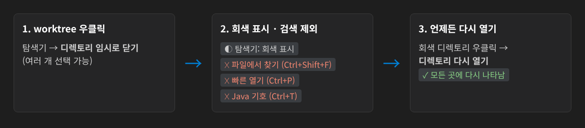
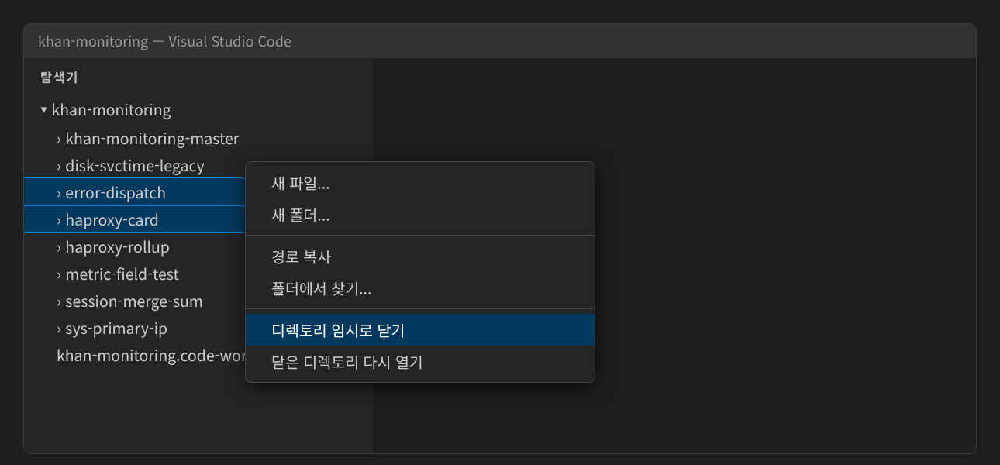
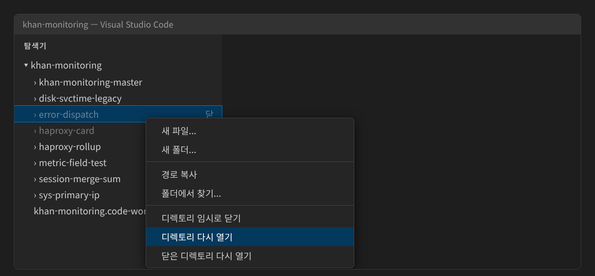
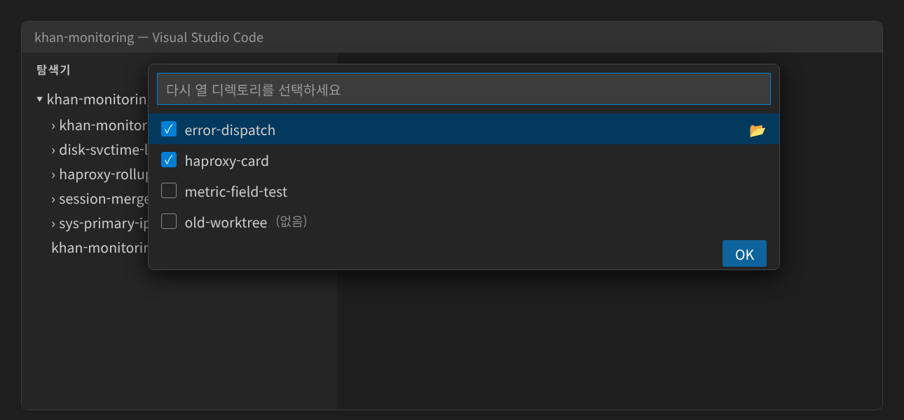

# Folder Stash

**이클립스의 프로젝트 닫기/열기처럼 하위 디렉토리를 닫고 엽니다. 닫은 디렉토리는 검색에서도 빠집니다.**

> [English](README.md)

한 폴더 아래에 git worktree(또는 모듈)를 여러 개 두고 작업하면, 검색할 때 모든 worktree가 함께 나옵니다.
파일에서 찾기, 빠른 열기, 기호로 이동에서 같은 클래스가 worktree 개수만큼 보입니다.
검색 필터로 걸러낼 수는 있지만 매번 입력하기 번거롭습니다.

Folder Stash는 지금 작업하지 않는 디렉토리를 **닫아 두고**, 필요할 때 다시 **열 수 있게** 해 줍니다.



## 닫기

탐색기에서 디렉토리를 우클릭(여러 개 선택 가능) → **디렉토리 임시로 닫기**



닫은 디렉토리는 탐색기에 **회색으로 남고** 오른쪽에 `닫` 표시가 붙습니다. 파일에서 찾기와 빠른 열기에서는 빠집니다.
탐색기에서도 완전히 숨기려면 설정 `folderStash.closeStyle`을 `hide`로 바꿉니다.

## 다시 열기

회색 디렉토리를 우클릭 → **디렉토리 다시 열기** (여러 개 선택 가능)



목록에서 고르려면 탐색기 아무 곳이나 우클릭하거나, 명령 팔레트(Ctrl+Shift+P)에서 **닫은 디렉토리 다시 열기**를 실행합니다.
숨김(`hide`) 방식에서는 이 방법을 씁니다. 다시 열 디렉토리를 체크하고 Enter를 누릅니다.



- 📂 버튼(바로 다시 열기): 그 디렉토리 하나만 바로 다시 엽니다.
- `(없음)`: 디스크에서 삭제된 디렉토리입니다. 📂로 정리합니다.

## 닫으면 빠지는 곳

| 기능 | 회색(`dim`, 기본) | 숨김(`hide`) |
|---|---|---|
| 탐색기 | 회색으로 표시 | 숨김 |
| 파일에서 찾기(Ctrl+Shift+F), 빠른 열기(Ctrl+P) | 제외 (`search.exclude`) | 제외 (`files.exclude`) |
| 작업 영역의 기호로 이동(Ctrl+T), 정의로 이동 (Java) | 제외 (`java.import.exclusions`) | 같음 |

- 회색 디렉토리도 펼쳐서 파일을 열 수는 있습니다. VS Code에는 폴더 펼치기를 막는 기능이 없습니다.
- 빠른 열기의 **최근에 연 파일** 목록에는 닫기 전에 열었던 파일이 남을 수 있습니다.
- 회색은 편집기 탭처럼 같은 파일이 보이는 다른 곳에도 적용될 수 있습니다.
- 원격(Remote-SSH 등)에서는 회색 디렉토리 우클릭 메뉴가 보이지 않을 수 있습니다. 이때는 **닫은 디렉토리 다시 열기** 목록을 씁니다.

- 설정은 `.vscode/settings.json`에 저장됩니다. 확장이 넣은 항목만 추가·제거하고, 직접 넣은 항목은 그대로 둡니다.
- Java 제외 목록이 바뀌면 **다시 불러오기** 알림이 뜹니다.
  - 닫을 때: `Java: Clean Java Language Server Workspace` (이미 불러온 프로젝트를 빼려면 필요)
  - 열 때: `Java: Import Java projects in workspace`
- 파일에서 찾기의 **제외 설정 및 무시 파일 사용**(톱니 아이콘)을 끄면 닫은 디렉토리도 검색됩니다.

## 설정

| 설정 | 기본값 | 설명 |
|---|---|---|
| `folderStash.closeStyle` | `dim` | `dim`: 탐색기에 회색으로 남김 / `hide`: 탐색기에서도 숨김. 바꾸면 닫아 둔 디렉토리도 바로 옮겨짐 |
| `folderStash.excludeFromJava` | `true` | 닫은 디렉토리를 Java 프로젝트 불러오기에서도 제외 |

## 동작 규칙

- 닫은 목록은 VS Code 내부 저장소(workspaceState)에 폴더별로 저장됩니다.
- `.vscode/settings.json`의 `search.exclude`/`files.exclude`에서 항목을 직접 지우면, 다시 연 것으로 보고 목록과 Java 제외에서도 뺍니다.
- `search.exclude`나 `files.exclude`에 직접 넣어 둔 경로는 닫기 대상에서 건너뜁니다. 그래서 다시 열기로 지워지지 않습니다.
- 다시 열면 `search.exclude`와 `files.exclude` 양쪽에서 이 경로의 `true` 항목을 지웁니다.
- `closeStyle`을 바꾸거나 이전 버전에서 업데이트하면, 닫아 둔 항목이 다른 설정으로 옮겨지며 `.vscode/settings.json`이 바뀝니다.
- 닫힌 상태에서 사용자 설정의 `java.import.exclusions`를 바꾸면, 모두 다시 열 때까지 이 폴더에는 반영되지 않습니다.
- `.vscode/settings.json`이 git으로 관리되고 있으면, 닫기만 해도 그 파일이 수정됩니다(`java.import.exclusions`에는 절대 경로가 들어감).
  커밋하지 않도록 주의하거나 `.gitignore`에 넣으세요.
- 항목 값을 `false`나 `when` 조건으로 바꾸면 다시 연 것으로 보고, 직접 쓴 값은 그대로 둡니다.

## 빌드 / 설치

```bash
./package.sh      # (처음이면 npm install) + 타입 체크 + 테스트 + vsix 생성
./install.sh      # 패키징 후 VS Code에 설치
```

## 라이선스

Apache-2.0
